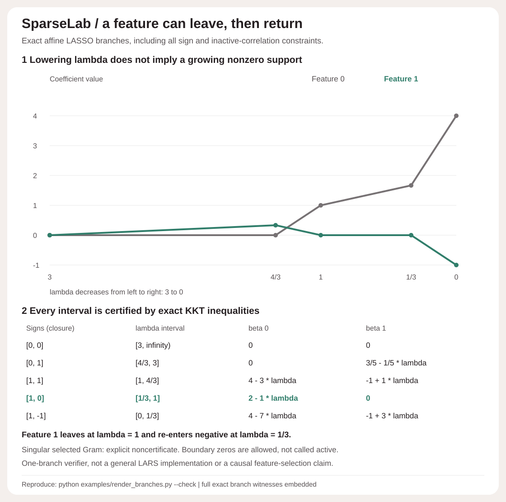

# Exact affine regularization branches

For the stored-input problem

```text
min_beta ||y - X beta||^2 / (2N) + lambda ||beta||_1, lambda >= 0
```

`branch(X, y, signs)` verifies one supplied weak active/sign branch. It does not run coordinate descent, automatically select a sign pattern, walk knots, or enumerate a general full path. It returns the maximal closed nonnegative-lambda interval for that branch, all its exact half-line constraints and bound ties, affine coefficients/correlations, and exact endpoint/interior primal-dual witnesses. The developed two-feature demo supplies five patterns explicitly; their intervals cover its path. That coverage is a property of this fixture, not a general path-completeness guarantee.



## Derivation and semantics

Let `G = X^T X / N`, `h = X^T y / N`. The caller supplies integer signs in `{-1, 0, 1}`. The selected set `A` consists of nonzero supplied signs. Coefficients outside `A` are fixed at zero. If `G_AA` is nonsingular, solve exactly:

```text
G_AA a_A = h_A
G_AA d_A = -s_A
beta(lambda) = a + lambda d
c(lambda) = h - G beta(lambda) = c0 + lambda c1
```

The selected correlation identities `c0_A = 0` and `c1_A = s_A` hold exactly. Intersect these remaining scalar inequalities:

```text
lambda >= 0
s_j (a_j + lambda d_j) >= 0                         for j in A
-c0_j + lambda (1 - c1_j) >= 0                     for j outside A
 c0_j + lambda (1 + c1_j) >= 0                     for j outside A
```

Every inequality is `u + lambda v >= 0`: if `v > 0`, it gives a lower bound `-u/v`; if `v < 0`, it gives an upper bound; if `v = 0`, it is either always satisfied or impossible. The intersection is a closed interval, a singleton, or empty. An absent upper bound is `null`, not a floating infinity. Every constraint and its bound remain in the report, including all ties. Lower greater than upper or a negative constant constraint is explicitly infeasible. No tolerance or rounded knot is used.

For a nonzero coefficient these conditions give `c_j = lambda sign(beta_j)`. For a zero coefficient they give `|c_j| <= lambda`, including at selected coordinates on the boundary. These are exactly the convex LASSO KKT conditions, so every point on a certified interval is globally optimal for this stored rational model. Conversely, any optimizer on this same affine weak-sign branch satisfies every displayed constraint, proving interval maximality **for this branch**. This is not a proof that every optimum must lie on it.

The inequalities are intentionally weak: a supplied nonzero sign does not mean its coefficient is nonzero at an endpoint. `selected` is not a recovered support. `strict_selected_signs_at_probe` reports strictness at the one reported interior probe, not a general strict-sign guarantee. A singleton can be certified even though no strict-sign interior exists. At `lambda = 0`, the same KKT argument reduces to the least-squares normal equations. Unlike the positive-lambda fitting/screening APIs, branch intervals can include this endpoint.

At each reported endpoint and interior probe, take `r = y - X beta`, `u = r/N`. Exact KKT implies `|X^T u| <= lambda`. The report independently evaluates

```text
P = ||r||^2/(2N) + lambda ||beta||_1
D = y^T u - N||u||^2/2
P - D = 0
```

No division by lambda is used, so the zero endpoint also has a valid witness. Endpoint snapshots alone would not prove an entire interval; that claim comes from the complete affine KKT inequalities.

## Developed drop/re-entry control

Take centered orthogonal four-row columns `a = [1,1,-1,-1]` and `b = [1,-1,1,-1]`, with `X = [a, 2a+b]` and `y = 2a-b`. Thus

```text
G = [[1, 2], [2, 5]], h = [2, 3]
```

`G` is positive definite (determinant 1, first principal minor 1), so coefficients for this fixture are unique. Column norms are not standardized: there is no hidden preprocessing, intercept or unpenalized column. This deliberately small example demonstrates an optimization property, not a real dataset or a feature-importance result.

| Supplied signs | Closed lambda interval | beta 0 | beta 1 |
| --- | --- | --- | --- |
| `[0,0]` | `[3,infinity)` | `0` | `0` |
| `[0,1]` | `[4/3,3]` | `0` | `(3-lambda)/5` |
| `[1,1]` | `[1,4/3]` | `4-3lambda` | `-1+lambda` |
| `[1,0]` | `[1/3,1]` | `2-lambda` | `0` |
| `[1,-1]` | `[0,1/3]` | `4-7lambda` | `-1+3lambda` |

Read downward as lambda decreases. Feature 1 enters positive at 3, feature 0 enters at 4/3, feature 1 leaves at 1, and feature 1 re-enters negative at 1/3. This is an explicit counterexample to monotonically growing nonzero support, not a claim about how often dropouts happen. Adjacent branches agree exactly in coefficients, predictions, objectives and dual vectors at every shared knot. The last endpoint is the least-squares solution `[4,-1]`.

The demo also includes an infeasible sign pattern, a zero-lambda singleton, and identical-column controls. Selecting both identical columns gives `singular_active_gram`, an explicit noncertificate. Selecting either one separately gives two certified branches with different coefficients and identical predictions. A singular report is **not** a proof of no optimum or no valid branch. The method intentionally does not substitute a ridge or pseudoinverse, return a continuum, or claim uniqueness in singular models.

## Reproduce and inspect

```sh
python -m sparselab branch-demo
python -m sparselab branch examples/branch-input.json
python examples/render_branches.py --check
python -m unittest discover -s tests -v
```

`branch` input has exactly `schema_version` (integer 1), `X`, `y`, `signs`. It shares the original validation: 1..128 rows, 1..12 columns, finite nonboolean numeric X/y values of absolute value at most 100, nonzero column mean squared norm at least 1e-8. Signs must be actual integers -1, 0 or 1, not booleans, floats or strings. API accepts lists/tuples. CLI rejects missing/unknown/duplicate keys, nonfinite JSON, invalid UTF-8 and inputs over 100000 bytes. Every validated numeric X/y value is converted to binary64 first and then to its exact rational representation. Results are certificates for those stored inputs, not intended decimal values or unknown pre-rounding measurements. There are no stochastic operations or external services.

62 tests retain all 45 prior checks and add 14 branch behavior tests plus 3 figure checks. Every endpoint/probe equation is reconstructed independently; the entire fixture has closed-form coefficient and Gram checks. Twelve seeded five-row/three-feature designs test all 27 supplied sign patterns, compare valid dyadic samples with the independent per-lambda active/sign enumeration oracle, and verify exact KKT and zero primal-dual gaps at all accepted endpoints/probes. Additional tests cover all bound ties and outside-interval violations, continuity/drop/re-entry, singular versus infeasible versus singleton, zero columns, unbounded zero branches, row replication/permutation, column permutation/scaling, response sign, binary64 semantics, 128 x 12 capacity, no mutation/RNG changes and strict CLI behavior. Figure checks verify all 20 table cells and coordinates, both entire line paths and all 10 vertex coordinates, five exact knot labels, full report metadata, a hidden singular-Gram tamper and byte-exact regeneration. Seven-module wheel parity compares all 6 complete CLI outputs outside the source checkout. The original solver, oracle, demos, screening and both prior SVGs remain unchanged.

## Attribution and limits

Piecewise-affine LASSO paths and coefficient drop steps are established methods. See Efron, Hastie, Johnstone and Tibshirani, *Least Angle Regression* (2004), [paper](https://export.arxiv.org/pdf/math/0406456v2.pdf), and Rosset and Zhu's [discussion](https://export.arxiv.org/pdf/math/0406470v1.pdf), section 2 on piecewise-linear regularized solution paths. This implementation applies standard KKT/linear algebra to the repository's mean-loss normalization; it is not a novel theorem, replacement for LARS, performance benchmark, or a proof that a general supplied path is complete. The branch API and the per-lambda oracle share an exact linear-system helper, so their comparison is not independent linear-algebra implementation coverage; equation reconstruction, analytic fixtures and transformations cover that limitation separately. No optimization speedup, causal interpretation, feature-selection consistency or predictive advantage is claimed.
