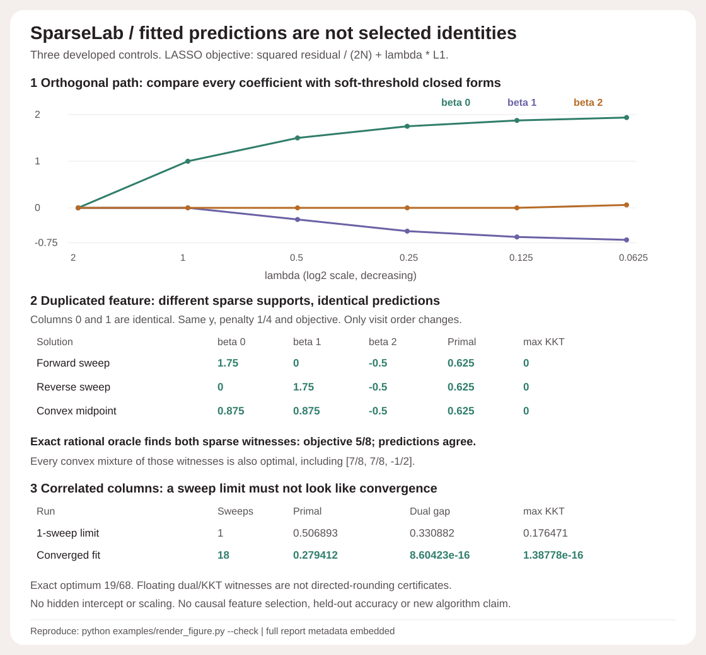
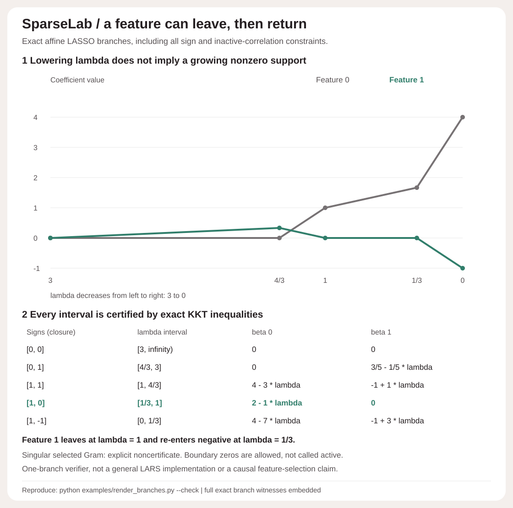

# SparseLab

A dependency-free LASSO reference that makes optimality and coefficient ambiguity visible. Fit small supplied regressions, inspect every sweep, and compare floating-point primal/dual/KKT witnesses with an independent exact-rational active/sign enumerator.

**A unique fitted prediction does not imply a unique selected feature.** In the duplicate-column control, forward sweeps select `[1.75, 0, -0.5]`, reverse sweeps select `[0, 1.75, -0.5]`, and their midpoint `[0.875, 0.875, -0.5]` is equally optimal. All have objective `5/8`, identical predictions and zero KKT residual. This is optimization geometry, not causal feature importance.



## Run offline

Python 3.10+, standard library at runtime. No credentials, downloads, datasets or paid APIs.

```bash
python -m sparselab demo
python -m sparselab path examples/input.json
python -m unittest discover -s tests -v
python examples/render_figure.py --check
python -m pip wheel --no-deps . -w dist
```

The demo asserts both a successful fit and a one-sweep nonconvergence control. [Full demo JSON](examples/demo.json), [caller input](examples/input.json) and [equations and limits](DESIGN.md) are committed. CLI inputs are capped at 100,000 bytes; reports may be larger because they include the full sweep history.

```python
from sparselab import fit, path, witness, enumerate_optima

result = fit([[1, 1], [1, -1]], [2, 0], penalty=0.25)
assert result['converged']
print(result['coefficients'], result['primal'], result['dual'], result['gap'])
print(result['correlations'], result['dual_vector'], result['max_kkt'])

# Strictly descending positive penalties; each fit starts from the previous fit.
report = path([[1, 1], [1, -1]], [2, 0], [1, 0.5, 0.25])
exact = enumerate_optima([[1, 1], [1, -1]], [2, 0], 0.25)
```

## What is actually computed

- Minimize `||y-X beta||^2/(2N) + lambda*||beta||_1`. No hidden intercept, centering or standardization. Every supplied column, including an explicit constant column, is penalized.
- Cyclic soft-threshold updates with recomputed partial residuals, configurable column order and initialization. Zero columns are handled explicitly.
- At every full sweep: primal objective, feasible scaled-residual dual vector, all dual correlations, stable decomposed gap, direct primal-minus-dual difference, every KKT residual and support.
- Stop only when **both absolute gap and maximum KKT residual are at most `tolerance`**. Otherwise return `status="sweep_limit"`, not a fabricated success. `path.all_converged` propagates failures.
- A separate bounded `Fraction` oracle enumerates `3^p` inactive/positive/negative patterns, solves nonsingular active normal equations with exact rational elimination, and accepts only exact KKT witnesses. Fractions represent the validated binary64 inputs exactly, not decimal idealizations. Singular patterns are counted and skipped, not ridge-regularized.

## Three developed controls

| Control | Observed result | Interpretation |
|---|---|---|
| Orthogonal Hadamard columns | Six penalties `[2,1,1/2,1/4,1/8,1/16]`; coefficients exactly follow soft-thresholding of `[2,-3/4,1/8]` | Independent closed forms, not a real-data benchmark |
| Duplicate columns | Two exact sparse witnesses, same predictions and exact objective `5/8`; their continuum of convex mixtures is optimal | Feature identity/support is not identified by the fit |
| Correlated columns | One sweep: gap `0.330882353`, max KKT `0.176470588`; converged at 18 sweeps with objective `19/68` | A sweep limit is not an optimality check; exact oracle agrees with the final fit |

The one-sweep run uses the **same objective, data, initialization and order** as the converged run. It is an explicitly truncated negative control, not a competitive baseline. No speed or optimizer-superiority claim.

## Verification

The original 28 tests (retained): 25 behavior/CLI tests plus 3 figure tests. Analytic scalar/orthogonal controls, ten seeded exact-rational comparisons, duplicate solutions and convex mixtures, primal/dual equations and weak duality, history monotonicity, warm/cold agreement, response/feature signs, row/column permutation, row replication, scale/penalty equivalence, zero columns, honest sweep limits, strict malformed inputs, nonmutation and unchanged global RNG state.

The SVG checks cover all 18 coefficient points/polyline geometry, all 23 summary cells and their coordinates, full compressed JSON metadata, hidden intermediate-history tampering, and byte-exact regeneration. CI runs Python 3.10-3.13. The original five-module packaging check reproduced both CLI outputs; the extension below raises this to six modules and all four outputs.

## Exact Gap Safe screening extension

`screen(X,y,coefficients,penalty)` audits a supplied iterate with exact rational arithmetic over the stored binary64 inputs. It constructs an exactly feasible dual point and gap, then uses `R_squared=2*gap/N` and a **strict, square-root-free** sphere test to certify some coordinates zero in every optimizer. It does not change the floating solver or claim acceleration.


A near iterate with current coefficient `beta_2=1/32` has exact gap `5/1024` and certifies that its optimum coefficient is zero. Its exact ball term `5/512` is below squared margin `25/1024`, leaving strict slack `15/1024`. But at another exact optimum `beta_2=0` lies on the dual boundary: gap and radius are zero yet the strict test cannot certify that feature. Duplicate features are also correctly left uncertified. `not_certified` never means active or relevant.

```bash
python -m sparselab screen-demo
python -m sparselab screen examples/screen-input.json
python examples/render_screening.py --check
```

[Derivation, all six controls and arithmetic scope](SCREENING.md) · [Complete screening report](examples/screen-demo.json). The original 28 checks remain; 14 new behavior and 3 new SVG checks bring the total to **45 tests**. Includes 24 additional seeded exact-oracle soundness/ball-containment comparisons, strict equality, all exact equations and replication/scaling controls. New figure checks all 27 exact cells, two squared-bound bar geometries, full rational metadata and hidden-dual tampering. A six-module v0.2 wheel reproduces all four complete CLI JSON outputs outside checkout; both SVGs regenerate byte-exactly. Original core/oracle/demo/figure unchanged.

Standard rule: Fercoq, Gramfort and Salmon, [Mind the duality gap: safer rules for the Lasso](https://proceedings.mlr.press/v37/fercoq15.html). Exact statements concern the rational model of the supplied stored inputs, not unknown pre-rounding data, causal relevance, statistical coverage or every true zero. No new screening theorem or speedup claim.

## Scope and attribution

This is a small dense numerical reference, not a scalable sparse solver. Fits accept at most 128 rows and 12 columns; the exact oracle accepts at most 32 rows and 5 columns. Positive penalties only. Supplied entries are bounded and nonzero columns need mean squared norm at least `1e-8`. See [DESIGN.md](DESIGN.md) for all limits and arithmetic qualifications.

Floating-point dual/KKT witnesses are **not directed-rounding certificates**. Positive ridge is not silently added to remove nonuniqueness. Coefficients depend on feature units and may be nonunique. No cross-validation, held-out prediction claim, feature causality, statistical coverage, post-selection inference, logistic model or new optimization algorithm.

Standard methods: Friedman, Hastie and Tibshirani, [Regularization Paths for Generalized Linear Models via Coordinate Descent](https://pmc.ncbi.nlm.nih.gov/articles/PMC2929880/), especially Section 2; Ryan Tibshirani's [Coordinate Descent notes](https://www.stat.cmu.edu/~ryantibs/convexopt/lectures/coord-desc.pdf) for soft-threshold/KKT and LASSO dual geometry. SparseLab's implementation, exact witnesses, controls and report format are original code applying those methods. MIT license.

## Exact affine branch extension

A feature can leave the LASSO support and later return with the opposite sign. `branch(X, y, signs)` solves one supplied branch's exact Gram equations and intersects all affine sign/inactive KKT inequalities. It returns the maximal closed nonnegative-lambda interval for that weak-sign branch, every bound/tie and exact zero-gap endpoint/interior witnesses. The developed two-feature control covers lambda from infinity to 0 with five explicitly supplied branches: feature 1 leaves at 1 and re-enters negative at 1/3. Adjacent knots agree exactly. Singular selected Grams are explicit noncertificates, not silently ridged or called infeasible.



```bash
python -m sparselab branch-demo
python -m sparselab branch examples/branch-input.json
python examples/render_branches.py --check
```

[Derivation, exact interval table, weak-sign/singular semantics and limits](BRANCHES.md) · [complete exact report](examples/branch-demo.json) · [caller input](examples/branch-input.json).

62 tests retain all 45 prior checks and add 14 branch behavior checks plus 3 figure checks. Twelve seeded five-row/three-feature designs exercise all 27supplied sign patterns, reconstruct accepted endpoint/interior KKT and zero gaps, and compare dyadic in-interval samples with the independent per-lambda enumerator. Analytic knots, all limiting ties/outside violations, transformations/N normalization, singleton/empty/singular controls, strict JSON and 128 x 12 capacity are checked. The third SVG verifies 20 table cells, both full path geometries/all 10vertices, five knots and full exact metadata including hidden-Gram tampering. The seven-module v0.3 wheel reproduces all six complete CLI JSON outputs outside checkout; all three SVGs regenerate byte-exactly. Original solver/oracle/demos/screening outputs are unchanged.

This is a one-branch verifier with standard KKT/linear algebra, not a general LARS/path-following implementation, full-path completeness guarantee, novel theorem or speed benchmark. Selected signs allow boundary zeros and are not a recovered support. Exactness concerns the stored binary64 inputs interpreted as rationals, not unknown pre-rounding data. The per-lambda oracle shares a linear-system helper; independent equation reconstruction and closed-form fixtures supplement that comparison. Established piecewise-linear path methods are credited in [BRANCHES.md](BRANCHES.md). No causal feature meaning or predictive advantage is claimed.
